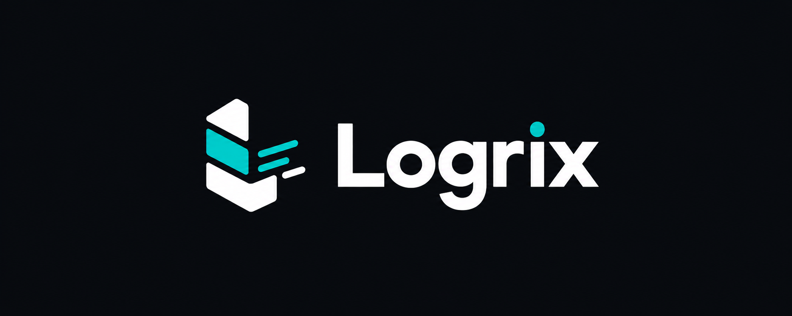

<p align="center">
  
</p>

<p align="center">
  <strong>High-performance, self-hosted, Kubernetes-native blockchain indexer built in Rust.</strong><br />
  Write custom event indexing logic in TypeScript with <a href="packages/logrix-sdk"><code>logrix-sdk</code></a> and deploy production indexer clusters to Local Kubernetes or AWS EKS in seconds.
</p>

<p align="center">
  <a href="LICENSE"></a>
  <a href="https://www.rust-lang.org/"></a>
  <a href="https://github.com/Vishal-770/Logrix/actions"></a>
  <a href="https://github.com/Vishal-770/Logrix/pkgs/container/logrix"></a>
  <a href="https://github.com/Vishal-770/Logrix/pkgs/container/charts%2Flogrix"></a>
  <a href="https://github.com/Vishal-770/Logrix/pkgs/npm/%40logrix%2Fsdk"></a>
</p>

---

## Why Logrix?

Most blockchain indexers force you into expensive proprietary cloud subscriptions with vendor lock-in, or crash when network reorgs and RPC rate-limits occur.

**Logrix is engineered for 100% data sovereignty, cost control, and high-throughput production:**

- **Custom Event Logic with TypeScript:** Write custom business logic and state transformations using [`@logrix/sdk`](packages/logrix-sdk) (compiled to sandboxed WebAssembly) or zero-code Declarative YAML.
- **Zero-Dependency Kubernetes Deployment:** Mount custom WASM binaries and GraphQL schemas directly into standard pods via Kubernetes Secrets. No custom Docker builds or S3 buckets required.
- **High-Throughput Ingestion:** Vectorized PostgreSQL writes (`UNNEST` arrays) processing **>20,000 events/second**.
- **Zero Silent Data Loss (Reorg Safe):** In-memory parent-hash rolling buffer detects forks, executes atomic database rollbacks (`is_reverted = TRUE`), indexes the canonical winning block immediately, and self-heals gaps.
- **RPC Billing Protection:** Multi-provider failover pool with per-provider circuit breakers, decorrelated jitter, and a built-in Compute Unit (CU) ledger that pauses backfills before exceeding your monthly budget.
- **Dual Storage Tiering:** Hot GraphQL entities in PostgreSQL; raw full block envelopes compressed with **`zstd`** into cold AWS S3/MinIO buckets, slashing cloud database storage bills by up to 85%.
- **Kubernetes Native (Local & AWS):** Microservice architecture with active-passive Ingester leader election (Kubernetes Leases) and event-driven worker autoscaling via **KEDA** (1 to 50+ pods).

---

## 1. Writing Custom Event Logic (`@logrix/sdk`)

### Scaffold a New Indexer Project
```bash
npx @logrix/sdk init my-indexer
cd my-indexer
npm install
```

### Generate Strongly Typed Bindings
```bash
npm run codegen
```

### Write Handler (`handlers/mapping.ts`)
```typescript
import { TransferEvent } from "./generated/events";
import { TransferEntity } from "./generated/schema";

export function handleTransfer(event: TransferEvent): void {
  let entity = new TransferEntity(event.transactionHash + "-" + event.logIndex.toString());
  entity.blockNumber = event.blockNumber;
  entity.fromAddress = event.params.from;
  entity.toAddress = event.params.to;
  entity.amount = event.params.value;
  entity.transactionHash = event.transactionHash;
  entity.timestamp = event.blockTimestamp;
  entity.save();
}
```

### Compile to WebAssembly
```bash
npm run build
```

### Export Helm Deployment Bundle
```bash
npm run export-values
```
Generates `indexer-values.yaml` bundling your compiled WASM handler (`config.wasmBase64`), GraphQL schema, and contract manifest.

---

## 2. Deployment Architecture

Logrix is a Kubernetes-native indexing system supporting two streamlined, production-grade deployment modes:

---

### Mode 1: Self-Hosted Kubernetes (Zero-Configuration Default)

Deploy directly to any Kubernetes cluster (Minikube, Kind, K3s, bare-metal, or on-premises Kubernetes).
Runs out-of-the-box with built-in, in-cluster **PostgreSQL 16** and **RabbitMQ 3.13** pods—no external dependencies or separate manifests needed:

```bash
helm install my-indexer oci://ghcr.io/vishal-770/charts/logrix \
  -f indexer-values.yaml
```

**Optional Cold S3 Archiving:**
S3 is 100% optional. If you want raw compressed block snapshots archived, enable built-in MinIO with:
```bash
helm install my-indexer oci://ghcr.io/vishal-770/charts/logrix \
  -f indexer-values.yaml \
  --set builtIn.minio=true
```

**Using External Database or Queue (BYO Infrastructure):**
To connect your own PostgreSQL or RabbitMQ, configure your connection strings in `deploy/secrets.example.yaml` and apply:
```bash
kubectl apply -f deploy/secrets.example.yaml

helm install my-indexer oci://ghcr.io/vishal-770/charts/logrix \
  -f indexer-values.yaml \
  --set config.existingSecret=logrix-secrets
```
The chart automatically detects your external database or queue and disables the corresponding built-in pod.

Port-forward and open the GraphQL playground:
```bash
kubectl port-forward svc/my-indexer-logrix-api 4000:4000
```
Visit **[http://localhost:4000/](http://localhost:4000/)** in your browser.

---

### Mode 2: Full AWS Production Deployment (EKS + Terraform)

Cloud-native AWS architecture powered by AWS EKS, AWS Aurora Serverless v2 PostgreSQL, Amazon SQS, Amazon S3 (optional), KEDA event-driven autoscaling, and IAM Roles for Service Accounts (IRSA).

#### Step 1: AWS Backing Infrastructure
- **Provisioning from Scratch via Terraform:** If starting from scratch, clone the Logrix repository to provision the full AWS VPC, EKS cluster, Aurora PostgreSQL, SQS queues, S3 archive bucket, and IRSA roles:
  ```bash
  git clone https://github.com/Vishal-770/Logrix.git
  cd Logrix/deploy/terraform/aws
  terraform init
  terraform apply
  ```
  Map the resulting outputs (`database_url`, `sqs_queue_url`, `s3_bucket_name`, and `iam_role_arn`) into `deploy/values-aws.yaml`.
- **Using Existing AWS Resources:** If your organization already has an Aurora cluster, SQS queue, and S3 bucket, configure your endpoints directly in `deploy/values-aws.yaml` and credentials in `deploy/secrets.example.yaml`.

#### Step 2: Deploy Helm Chart to AWS EKS
Connect kubectl to your EKS cluster:
```bash
aws eks update-kubeconfig --name <cluster-name> --region <aws-region>
```

Apply secrets and deploy the unified Helm release:
```bash
kubectl apply -f deploy/secrets.example.yaml

helm install my-indexer oci://ghcr.io/vishal-770/charts/logrix \
  -f deploy/values-aws.yaml \
  -f indexer-values.yaml \
  --set config.existingSecret=logrix-secrets
```

---

## 3. Live Monitoring & Observability

### Terminal Status Monitor (TUI)
Check sync progress, queue depth, and reorg history directly in your terminal:
```bash
logrix status --watch
```

### Prometheus Metrics for Grafana
The GraphQL API server exposes Prometheus metrics at **`http://localhost:4000/metrics`**:
- `logrix_head_lag_blocks`
- `logrix_events_indexed_total`
- `logrix_queue_depth{queue="live|backfill|webhook|dlq"}`
- `logrix_rpc_cu_consumed_total`
- `logrix_reorg_detected_total`

---

## License

Licensed under the Apache License, Version 2.0. See [LICENSE](LICENSE) for details.
